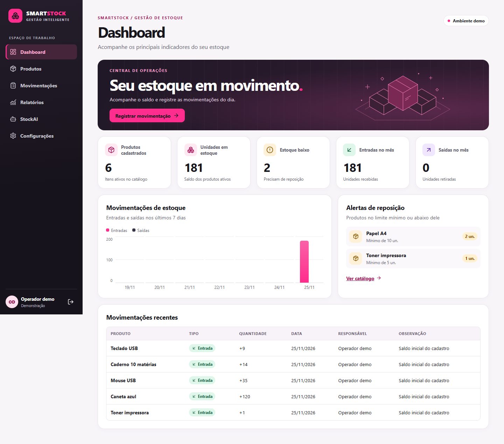

# SmartStock

Gestão de estoque em React, Node.js, Express e PostgreSQL. **Dia 3 do projeto / Aula 8** do Programa de Estágio de Férias.



| Dia | Aula | Entrega |
| --- | --- | --- |
| 1 | 6 | Planejamento e [seis referências em SVG](evidencias/dia-1/). |
| 2 | 7 | Interface React, operações locais, visual responsivo e prévia StockAI. [Versão preservada no GitHub](https://github.com/gugdev/smartstock/tree/5944396). |
| **3** | **8** | **API REST, PostgreSQL, integração das telas, Swagger, DER e testes.** |
| 4 | 9 | Planejado: IA e n8n. O envio no chat StockAI continua desabilitado. |

## Entrega e apresentação

- [Pasta do Dia 3 no Drive](https://drive.google.com/drive/folders/17JiQq1iswXzXDqlqRbPQ8MOVKucYV633).
- [Roteiro de apresentação e perguntas](docs/dia-3/roteiro.md).
- [DER em imagem](docs/dia-3/der.png), [explicação do banco](docs/dia-3/modelo-de-dados.md) e [SQL executável](server/schema.sql).
- [Especificação OpenAPI](docs/dia-3/openapi.json), [HTML de consulta para baixar e abrir](docs/dia-3/swagger.html) e [Swagger interativo local](http://127.0.0.1:3001/api/docs/).
- [Evidências do Dia 3](evidencias/dia-3/), [vídeo da integração](evidencias/dia-3/integracao.mp4) e [conferência direta dos saldos no banco](evidencias/dia-3/consulta-banco.txt).

O Swagger local exige API e PostgreSQL em execução na máquina de quem o abre. O JSON OpenAPI permite consultar a especificação sem iniciar o projeto. O HTML de consulta carrega o Swagger UI pela internet, sem enviar requisições à API. Não há uma implantação pública nesta entrega. Para regenerar JSON e HTML a partir do contrato atual, execute `npm run docs:exportar`.

## Executar

Requisitos: Node.js 22.12+ com npm e PostgreSQL 17+ em execução. Em um clone novo:

```bash
npm ci
```

No PostgreSQL, usando um administrador, crie um papel e um banco próprios. Troque a senha de exemplo:

```sql
CREATE ROLE smartstock LOGIN PASSWORD 'ESCOLHA_UMA_SENHA_LOCAL';
CREATE DATABASE smartstock OWNER smartstock;
```

Copie `.env.example` para `.env` e ajuste `DATABASE_URL` com usuário, senha, host, porta e banco. Se a senha tiver caracteres reservados em URL, codifique-os na URL de conexão. O arquivo `.env` fica fora do Git e do pacote de entrega.

```bash
npm run db:setup
npm run db:demo
```

`db:setup` cria as tabelas sem apagar dados. `db:demo` preenche um catálogo vazio com seis produtos e suas entradas iniciais. Não duplica a demonstração em um catálogo preenchido.

Abra dois terminais no VS Code:

```bash
# Terminal 1 — API
npm run server
```

```bash
# Terminal 2 — interface
npm run dev
```

Abra [SmartStock](http://127.0.0.1:5173) e [Swagger](http://127.0.0.1:3001/api/docs/). A configuração padrão da API é porta **3001**; o Vite encaminha `/api` para ela. Nesta máquina o PostgreSQL portátil usa a porta **5433**, já configurada no `.env` privado; uma instalação comum pode usar **5432**.

O acesso é **demonstrativo**: use `demo@smartstock.test` e `estoque123`. A senha apenas passa pela validação do formulário; não autentica chamadas à API. O servidor escuta somente em `127.0.0.1`. Perfil e estoque são compartilhados nesta demonstração local.

Depois de preparar as dependências e o banco, no Windows também é possível executar `./scripts/iniciar-local.ps1` no PowerShell. O script abre o VS Code e a interface e evita iniciar cópias de serviços que já estão ouvindo nas portas esperadas. A configuração opcional do PostgreSQL portátil desta máquina fica em `.local.json`, fora do Git.

No VS Code, **Terminal → Executar Tarefa** também oferece testes da API, conferência de saldos e compilação usando diretamente o Node. As tarefas de iniciar API e interface destinam-se ao uso quando esses serviços ainda não estiverem em execução.

Para servir a compilação pelo Express, na porta 3001:

```bash
npm run build
npm start
```

## Organização do código

Para acompanhar cadastros e movimentações automaticamente, abra o [Banco ao vivo](http://127.0.0.1:3001/monitor-banco), com a API e o PostgreSQL em execução. O monitor consulta `GET /api/produtos?status=todos` a cada **2 segundos** enquanto a aba está visível. Ele mostra o **ID completo**, permite copiar o ID, buscar por produto/categoria/ID e pausar ou retomar as consultas. É uma página de consulta dos dados do PostgreSQL pela API; não altera o banco.

Nesta instalação do VS Code, pressione **F1**, escolha **Browser: Open Integrated Browser** e informe `http://127.0.0.1:3001/monitor-banco` para deixar a tabela aberta dentro do editor. Ela também funciona no navegador comum. A grade de resultados da extensão PostgreSQL continua mostrando o resultado da última consulta SQL executada; a atualização periódica pertence à nova aba **Banco ao vivo**.

| Caminho | Responsabilidade |
| --- | --- |
| `src/main.jsx` | Sessão demo, rotas por hash, carga da API e atualização das telas. |
| `src/api.js` | Requisições HTTP e mensagens de falha. |
| `src/telas.jsx` | Formulários, catálogo, Dashboard, filtros de relatório e CSV. |
| `src/componentes.jsx` | Navegação, cartões, tabelas, gráfico e validação visual. |
| `src/estoque.js` | Funções de datas, apresentação e cálculos da interface. |
| `server/app.js` | Rotas Express e respostas de erro. |
| `server/validacao.js` | Validação de campos com Zod. |
| `server/estoque.js` | Regras de cadastro, saldo e histórico; SQL parametrizado. |
| `server/db.js` | Pool PostgreSQL e transações. |
| `server/schema.sql` | Tabelas, relacionamentos, restrições e índices. |
| `server/openapi.js` | Documentação Swagger de todas as rotas. |
| `scripts/monitor-banco.html` | Monitor de consulta com atualização periódica, IDs completos e busca. Servido em `/monitor-banco`. |
| `server/test/` | Testes reais de API e banco em schema temporário. |
| `docs/dia-3/` | Roteiro, DER, especificação e validação da entrega. |
| `evidencias/dia-1/`, `dia-2/`, `dia-3/` | Registros separados da evolução. |

## API

| Método | Recurso | Uso |
| --- | --- | --- |
| GET | `/api/saude` | Verifica conexão com o banco. |
| GET | `/api/estoque` | Catálogo, histórico e perfil numa mesma fotografia do banco. |
| GET | `/api/dashboard` | Totais de produtos ativos, unidades, estoque baixo e registros recentes. |
| GET / POST | `/api/produtos` | Busca e cadastro. Filtros: `busca`, `categoria`, `status`. |
| GET / PUT / DELETE | `/api/produtos/{id}` | Detalhe, edição e inativação. |
| PATCH | `/api/produtos/{id}/reativar` | Reativa o produto. |
| GET / POST | `/api/movimentacoes` | Histórico e registro de entrada ou saída. Filtros: `inicio`, `fim`, `produtoId`, `tipo`. |
| GET / PUT | `/api/perfil` | Perfil e preferência compartilhados da demonstração. |
| GET | `/api/openapi.json`, `/api/docs/` | Especificação e interface Swagger. |

Quantidades são inteiras. Estoque baixo significa saldo menor **ou igual** ao mínimo. O cadastro guarda descrição e data de criação e registra uma entrada para o saldo inicial positivo. A edição não aceita alteração direta da quantidade. Inativar preserva o histórico e bloqueia novos lançamentos até reativar.

Saldo e movimento são gravados numa transação, com bloqueio do produto durante a alteração. Um UUID de tentativa evita duplicar o movimento ao repetir a mesma requisição. Nomes de produto e responsável são preservados como estavam no momento do lançamento. O histórico segue a ordem de lançamento, mesmo com data retroativa.

O estoque deixou de usar `localStorage`: os dados do Dia 2 que já existirem no navegador não são apagados nem importados automaticamente. A nova demonstração do banco tem entradas iniciais completas, por isso o histórico e os totais de entradas diferem das simulações do Dia 2. Os filtros das telas e a geração do CSV continuam no React, usando os dados carregados da API; as rotas também permitem consultar produtos e histórico com filtros.

## Verificação

```bash
npm test
npm run db:verificar
npm run build
npm audit
```

Os testes de integração criam e removem somente um schema temporário no banco configurado. O papel precisa poder criar schemas; o dono do banco possui essa permissão. Eles cobrem concorrência, duplicidade, rollback, validações, catálogo, perfil e documentação. `db:verificar` só consulta o catálogo e compara cada saldo com seu histórico. Veja os [resultados e limites da entrega](docs/dia-3/validacao.md).

## Dias anteriores

- [Dia 1 no Drive](https://drive.google.com/drive/folders/1pJQsR94L1FCM4bPZbb5G1WI8UZ7Rw5Nl) e [Dia 2 no Drive](https://drive.google.com/drive/folders/1OAdEekY5SRHekIC_qeBtf2lokSnqcdz9).
- [Roteiro do Dia 2 na versão preservada](https://github.com/gugdev/smartstock/blob/5944396/docs/roteiro-dia-2.md).
- [Protótipo navegável no Figma](https://www.figma.com/proto/sojvdu4i568LOE80M4EpzJ/SmartStock-%E2%80%94-Prot%C3%B3tipo?node-id=3-2&page-id=0%3A1&starting-point-node-id=3%3A2&scaling=scale-down&content-scaling=fixed).

O planejamento inicial mencionava outra stack. A implementação do Dia 3 segue a orientação da Aula 8: **Node.js + Express + PostgreSQL**. IA e automação seguem para o Dia 4.
