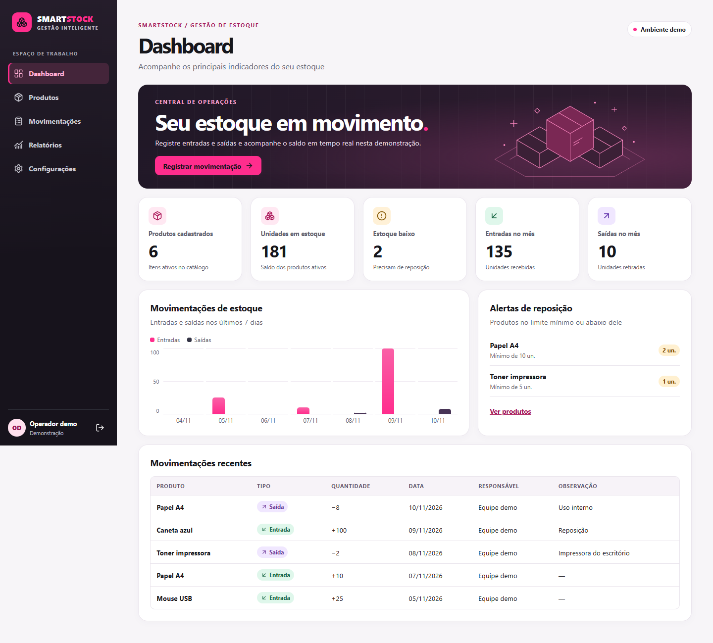

# SmartStock

Aplicação web de gestão de estoque. Esta versão corresponde ao **Dia 2 do projeto / Aula 7** do Programa de Estágio de Férias.



| Projeto | Aula | Evolução |
| --- | --- | --- |
| Dia 1 | 6 | Planejamento, regras de estoque, modelo de dados, arquitetura e [referências das telas em SVG](evidencias/dia-1/). |
| **Dia 2** | **7** | **Front-end navegável em React**, com operações locais e interface responsiva. |
| Dia 3 | 8 | Planejado. Integrar API, autenticação e banco de dados. |
| Dia 4 | 9 | Planejado. Integração com IA e n8n, testes e finalização. |

## Executar

Com Node.js 22.12+ e npm instalados, abra a pasta SmartStock no VS Code e rode no terminal:

```bash
npm ci
npm run dev
```

Abra [localhost:5173](http://127.0.0.1:5173) ou o endereço mostrado pelo Vite. Para testar o login de demonstração, use `demo@smartstock.test` e `estoque123`. A senha serve apenas para a validação do formulário. Para gerar a versão de produção, rode `npm run build`.

## O que demonstrar

1. Entre e aponte os indicadores do Dashboard e o gráfico de entradas e saídas.
2. Em **Produtos**, cadastre um item com 5 unidades e mínimo de 3. Edite o nome. O campo de saldo fica disponível apenas na criação para que os ajustes seguintes tenham histórico.
3. Em **Movimentações**, tente retirar 6 unidades. Depois retire 2. Mostre a mensagem de erro na primeira tentativa, o saldo de 3 na segunda e a linha no histórico.
4. Em **Relatórios**, filtre as saídas pelo produto e exporte o CSV.
5. Mostre **Configurações** e reduza a janela para demonstrar o menu móvel.

O atalho do dashboard leva direto ao registro de uma movimentação. No gráfico, passe o mouse sobre um dia ou selecione-o com Tab para conferir as quantidades de entradas e saídas.

## Como o código funciona

| Arquivo | Responsabilidade |
| --- | --- |
| [src/main.jsx](src/main.jsx) | Guarda o estoque e a sessão demo no estado do React e seleciona a tela pelo trecho da URL após `#`. |
| [src/componentes.jsx](src/componentes.jsx) | Reúne elementos reutilizados como navegação, cartões, tabelas, indicadores e gráfico. As telas passam dados por *props*. |
| [src/telas.jsx](src/telas.jsx) | Implementa as telas, os formulários, os filtros e a exportação do relatório. Cadastro e edição têm URLs próprias e usam o mesmo formulário. |
| [src/estoque.js](src/estoque.js) | Fornece dados fictícios, lê e grava o estoque no navegador e valida os movimentos antes de alterar saldo e histórico. |
| [src/estilo.css](src/estilo.css) | Aplica a identidade rosa e preta. As *media queries* recolhem o menu e reorganizam os cartões em telas menores. |

O `localStorage` guarda os dados no navegador após recarregar. O `sessionStorage` mantém o acesso de demonstração na aba. Quando o estoque muda, o React recalcula os indicadores usando os dados atualizados. Um produto é considerado em estoque baixo quando o saldo é menor **ou igual** ao mínimo. A inativação retira o produto do estoque operacional e preserva suas movimentações.

Na Aula 8, a API deverá fornecer os dados, validar permissões e gravar a atualização do saldo junto com a movimentação no banco. A interface atual usa operações locais de demonstração.

## Evidências

- [Dia 1 / Aula 6 — seis referências em SVG](evidencias/dia-1/). Os nomes e e-mails foram trocados por dados de demonstração na cópia pública. O link do Figma está pendente.
- [Dia 2 / Aula 7 — capturas das telas](evidencias/) e [dashboard em largura de celular](evidencias/09-dashboard-mobile.png).
- [Vídeo de navegação](evidencias/navegacao.mp4).
