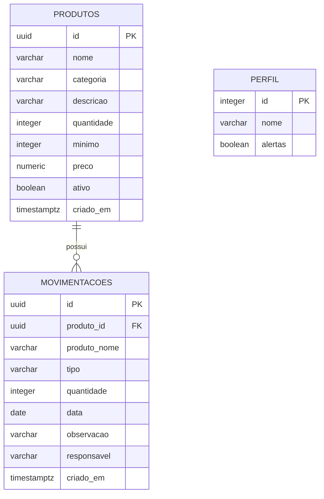

# Modelo de dados — Dia 3 / Aula 8

Implementação em PostgreSQL. O [SQL executável](../../server/schema.sql) é a fonte do modelo.

Um produto tem várias movimentações; cada movimentação pertence a um produto. A chave estrangeira impede referências a produtos inexistentes. A exclusão lógica usa `ativo=false` e conserva todo o histórico. A API permite reativar o produto.

`produto_nome` e `responsavel` guardam o texto do momento do lançamento. Renomear um produto ou perfil não reescreve registros anteriores. `data` representa o dia informado pelo operador, e `criado_em` representa a ordem de lançamento no servidor. Assim, lançar uma operação retroativa não altera a ordem de registro.

O saldo inicial positivo gera uma entrada. Depois disso, o saldo só muda por movimentações. Quantidades usam inteiros não negativos; preço usa `numeric(10,2)`. Há limites na API e restrições SQL. Saídas simultâneas bloqueiam a mesma linha com `FOR UPDATE`; saldo e histórico são confirmados no mesmo `COMMIT`. Uma falha causa `ROLLBACK`.

O perfil é único e compartilhado nesta demonstração. Não representa uma tabela de usuários autenticados. `responsavel` é uma cópia do nome informado, sem vínculo de auditoria com uma identidade autenticada. A preferência de alertas fica persistida para a integração futura, sem enviar notificações nesta etapa.

Diferença em relação ao planejamento inicial: a implementação segue o pedido da Aula 8, com Node.js, Express e PostgreSQL. A API usa UUIDs e mantém o histórico imutável pelo aplicativo; não há rota para editar ou apagar uma movimentação.
